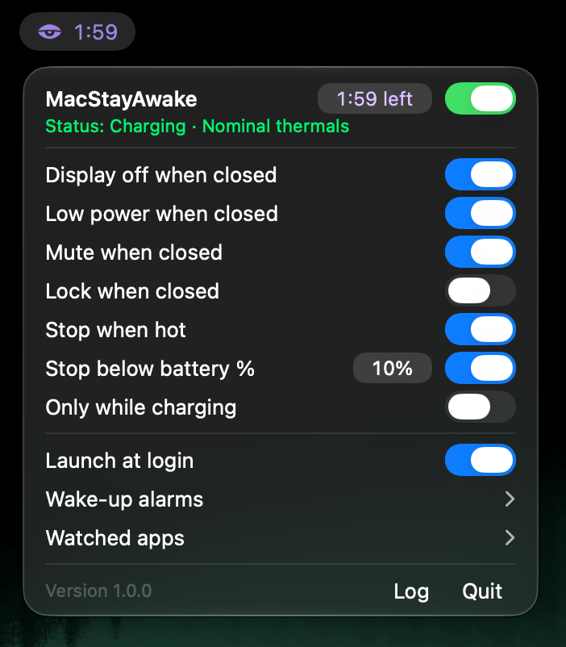

<p align="center">
  
</p>
<h3 align="center">MacStayAwake</h3>
<p align="center">
  A native mac app to keep your Mac working with the lid closed.<br/>
  <sub>Inspired by/forked <a href="https://github.com/Vladimir-Podgornyi/LidAwake">LidAwake</a> and <a href="https://github.com/deezeddd/LidAwake-Mac">LidAwake-Mac</a></sub>
</p>

<p align="center">
  
  <a href="./LICENSE"></a>
  <a href="https://github.com/e-simpson/mac-stay-awake"></a>
</p>

<p align="center">
  
</p>

### Features

- Mac stays awake when turned on, normal when off
- Right click menu bar icon to quick toggle
- Can change settings while closed:
  - Low power
  - Display & keyboard off
  - Mute audio
  - Lock
- Stops when you want
  - Optional timer or run forever
  - When thermals get hot
  - When battery is low
- Automate
  - Optional daily wake-ups
  - Watch app activity to stop idle sessions

See [how it works and its limits](./docs/architecture/POWER_SESSIONS.md).

## Download

Get the signed, Apple-notarized app for Apple silicon from [Releases](https://github.com/e-simpson/mac-stay-awake/releases/latest). Unzip it, move MacStayAwake to Applications, and open it.

## Build yourself

Physical compatibility and recovery testing across Macs and macOS versions is incomplete.

1. Configure your own Developer ID Application identity using [SIGNING.md](./SIGNING.md). Production packaging deliberately refuses the default unconfigured signing team.
2. From the repository root, build and install:

   ```sh
   scripts/build-app.sh
   scripts/install-app.sh
   ```

3. Open `/Applications/MacStayAwake.app`, select **Stay Awake**, and approve its helper in System Settings when prompted. Select **Normal** to restore the app's temporary changes and return control to your macOS settings.

Left-click opens the panel; right-click toggles Stay Awake. **Infinite** disables the timer while retaining enabled safety limits. Installation does not launch the app, approve its helper, or change power settings. The installer refuses replacement: quit the previous app normally and move it to Trash before updating.

### Preview without a signing identity

```sh
PREVIEW_BUILD=1 scripts/build-app.sh
open build/preview/MacStayAwake.app
```

The preview uses inert power/brightness services and cannot register the helper. It cannot test closed-lid behavior. Avoid running a preview alongside an installed copy.

## Requirements

- The full Xcode application, including command-line tools and the asset compiler. Development checks used Xcode 27.1; older toolchains remain unverified.
- The package targets macOS 13 or later. This is a deployment target, not a verified hardware/OS support matrix.
- Your own Developer ID Application signing identity for real power control. Developer membership alone does not install that identity.

Apple silicon is the default. `ARCH=x86_64 scripts/build-app.sh` produces a separate app in `build/x86_64/` for manual installation. Intel compilation and physical acceptance remain unverified.

## Verify and contribute

```sh
swift test
PREVIEW_BUILD=1 scripts/build-app.sh
```

Tests and previews do not prove physical sleep, wake, or recovery behavior. Contributions should preserve bounded power operations, app/helper authentication, and restoration guarantees. Include a focused check for changed behavior. See [SECURITY.md](./SECURITY.md) for security reports.

The included CI workflow runs tests and builds the inert preview. It does not sign releases or use signing credentials.

## Uninstall

If you use wake-up alarms, disable them first and wait for any scheduling error to clear. Quit MacStayAwake normally so it restores your settings, then move it to Trash.

The helper is bundled inside the app and managed by macOS through `SMAppService`; normal removal does not require a Terminal command. Its Login Items entry may take time to disappear. Scheduled wake events are separate, which is why alarms should be disabled first.

For explicit helper removal or troubleshooting, run this before trashing the app:

```sh
/Applications/MacStayAwake.app/Contents/MacOS/LidAwake --uninstall-helper
```

If restoration fails, keep the app and recovery records until it succeeds. No sudoers grant is installed.

## License and credits

MIT. Preserve [LICENSE](./LICENSE) and [LICENSE-BRIGHTNESS-REFERENCE](./LICENSE-BRIGHTNESS-REFERENCE) for the corresponding code.

- [Vladimir-Podgornyi/LidAwake](https://github.com/Vladimir-Podgornyi/LidAwake): native app/helper foundation. Upstream Git history is preserved.
- [deezeddd/LidAwake-Mac](https://github.com/deezeddd/LidAwake-Mac): brightness-preservation reference.

Exact source revisions and copyright notices are in [NOTICE](./NOTICE). MacStayAwake is independently maintained; attribution does not imply upstream endorsement.

## Disclaimer

MacStayAwake is developed with AI coding agents. It may contain bugs and has not been validated on every Mac or macOS version. Use it at your own risk, monitor your Mac's temperature and battery, and keep backups.

The software is provided "as is", without warranty. To the extent permitted by applicable law, the authors and copyright holders are not liable for claims, damages or losses arising from its use, including data loss, hardware damage or interrupted work. See the [MIT License](./LICENSE).
