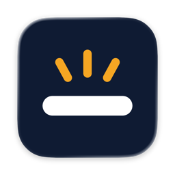
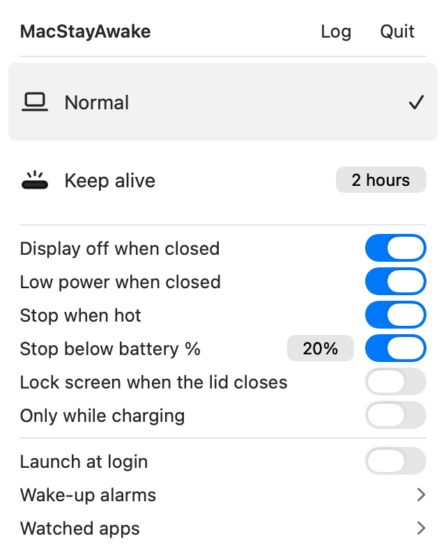
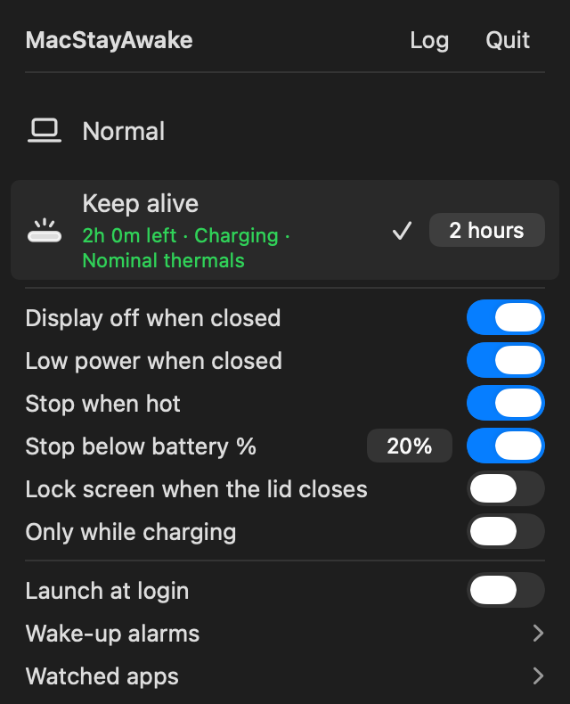

<p align="center">
  
</p>
<h3 align="center">MacStayAwake</h3>
<p align="center">Keep your Mac working with the lid closed, then restore your settings.</p>
<p align="center">
  
  <a href="./LICENSE"></a>
  
</p>

A native menu-bar app for closed-lid work on battery or external power. Based on [Vladimir Podgornyi's LidAwake](https://github.com/Vladimir-Podgornyi/LidAwake), with optional brightness and Low Power Mode handling, timers, daily wake alarms, and idle detection.

## Build and use

Source builds are available; public notarized downloads are not. Physical compatibility and recovery testing across Macs and macOS versions is incomplete.

1. Configure your own Developer ID Application identity using [SIGNING.md](./SIGNING.md). Production packaging deliberately refuses the default unconfigured signing team.
2. From the repository root, build and install:

   ```sh
   scripts/build-app.sh
   scripts/install-app.sh
   ```

3. Open `/Applications/MacStayAwake.app`, select **Keep alive**, and approve its helper in System Settings when prompted. Select **Normal** to restore the app's temporary changes and return control to your macOS settings.

Left-click opens the panel; right-click toggles Keep alive. **Infinite** disables the timer while retaining enabled safety limits. Installation does not launch the app, approve its helper, or change power settings. The installer refuses replacement: quit the previous app normally and move it to Trash before updating.

### Preview without a signing identity

```sh
PREVIEW_BUILD=1 scripts/build-app.sh
open build/preview/MacStayAwake.app
```

The preview uses inert power/brightness services and cannot register the helper. It cannot test closed-lid behavior. Avoid running a preview alongside an installed copy.

## Interface

<p align="center">
  
  
</p>

Screenshots use inert snapshot services and example state.

## Requirements

- The full Xcode application, including command-line tools and the asset compiler. Development checks used Xcode 27.1; older toolchains remain unverified.
- The package targets macOS 13 or later. This is a deployment target, not a verified hardware/OS support matrix.
- Your own Developer ID Application signing identity for real power control. Developer membership alone does not install that identity.

Apple silicon is the default. `ARCH=x86_64 scripts/build-app.sh` produces a separate app in `build/x86_64/` for manual installation. Intel compilation and physical acceptance remain unverified.

## What it does

- Keeps working with the lid closed on battery or external power; charging-only operation is optional.
- Optionally saves built-in brightness, sets it to zero while closed, and enables Low Power Mode. Opening or ending a session restores captured values.
- Offers a timer, battery cutoff, and thermal-pressure protection. Defaults are two hours, 20% battery, and thermal protection enabled.
- Manages up to 16 distinct daily wake alarms. Each can be edited, disabled, or deleted; new alarms start disabled.
- Offers Sleep when idle with watched apps. The panel follows system appearance/accent; screen locking and launch at login are opt-in.

The active subtitle shows only enabled timer, battery/charging, and thermal fields.

## App watching

Select apps inside **Watched apps** and enable **Sleep when idle**. During Keep alive, enough consecutive quiet minutes ends the session and restores temporary settings; macOS then controls sleep normally.

The watcher estimates CPU activity in commands launched by selected apps. It also considers system load, keyboard/mouse input, and other apps' keep-awake requests. It does not read Codex thread state: a model-response wait can appear idle. It does not automatically start or restart Keep alive. Without Sleep when idle enabled, selecting apps does not gate the session.

## Recovery and limits

The user app owns brightness recovery. An authenticated root helper owns bounded power operations, safety limits, and durable recovery records. Sessions require renewal and have a two-minute lease. See [the architecture](./docs/architecture/POWER_SESSIONS.md).

**Quit** restores temporary settings before exiting. Unavailable services or displays keep Quit pending while recovery retries automatically. Force Quit, shutdown deadlines, and power loss can interrupt recovery; restarting the app is required for interrupted brightness recovery.

Brightness zero does not guarantee the panel is physically powered off. Brightness uses private DisplayServices APIs. Unavailable displays defer restoration. Thermal protection does not guarantee safe operation in an enclosed bag. Low Power Mode can reduce performance, and legacy energy settings are refused when their original state cannot be restored safely.

Observable external changes are preserved. Avoid competing sleep-override utilities. Wake alarms intentionally survive Quit: only the next two queued occurrences per enabled alarm remain while the app is closed. Running the app replenishes them. Upstream binary update checks are disabled.

## Verify and contribute

```sh
swift test
PREVIEW_BUILD=1 scripts/build-app.sh
```

Tests and previews do not prove physical sleep, wake, or recovery behavior. Contributions should preserve bounded power operations, app/helper authentication, and restoration guarantees. Include a focused check for changed behavior. See [SECURITY.md](./SECURITY.md) for security reports.

The included CI workflow runs tests and builds the inert preview. It does not sign releases or use signing credentials. CI has not run on GitHub yet.

## Uninstall

Choose **Normal**, resolve any recovery message, and quit normally. Before moving the app to Trash, unregister its helper and cancel owned wake events:

```sh
/Applications/MacStayAwake.app/Contents/MacOS/LidAwake --uninstall-helper
```

Retain the app and recovery records if cleanup fails. Do not delete `/Library/Application Support/dev.personal.MacStayAwake` while recovery is pending. No sudoers grant is installed.

## License and credits

MIT. Preserve [LICENSE](./LICENSE) and [LICENSE-BRIGHTNESS-REFERENCE](./LICENSE-BRIGHTNESS-REFERENCE) for the corresponding code.

- [Vladimir-Podgornyi/LidAwake](https://github.com/Vladimir-Podgornyi/LidAwake): native app/helper foundation and retained icon. Upstream Git history is preserved.
- [deezeddd/LidAwake-Mac](https://github.com/deezeddd/LidAwake-Mac): brightness-preservation reference.

Exact source revisions and copyright notices are in [NOTICE](./NOTICE). MacStayAwake is independently maintained; attribution does not imply upstream endorsement.
